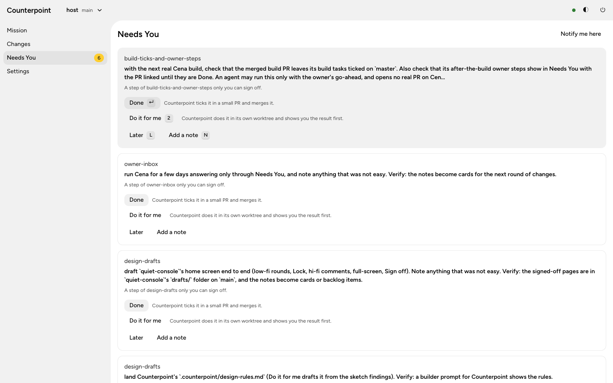
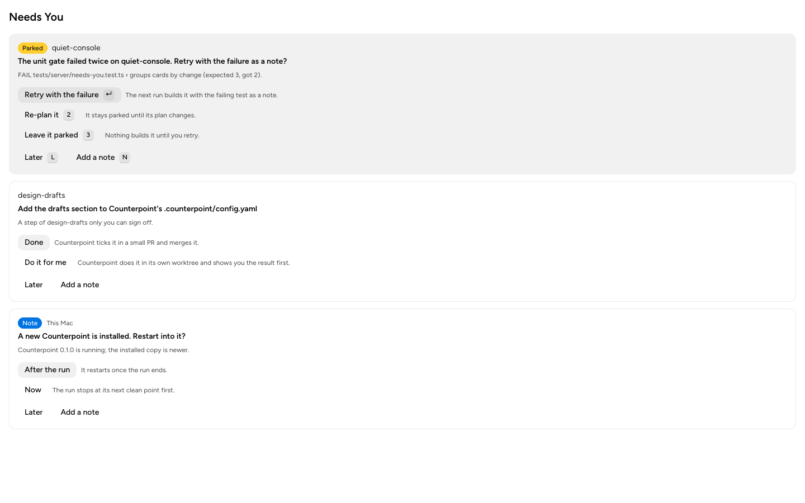
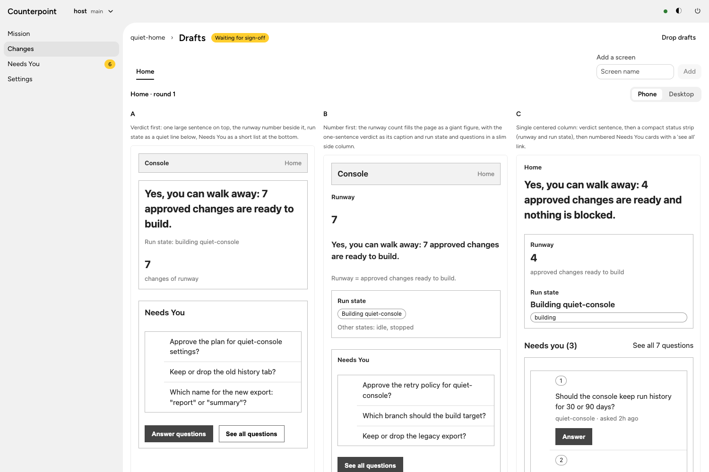
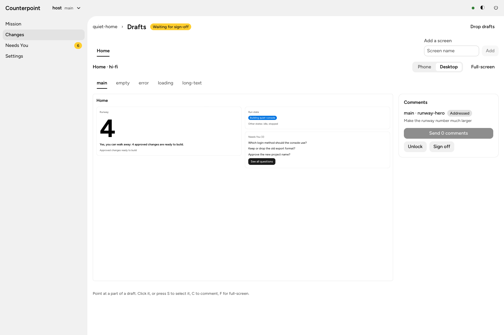

# Spike: rendering design drafts (design-drafts 1.1-1.3)

Measured 2026-11-13 on the owner's Mac (Node 24.21, claude with the default draft model `sonnet`), with a scratch Counterpoint daemon (own home, port 4199) on a scratch clone of Counterpoint.

## 1.1 Hi-fi: one console screen

`scripts/render-draft.ts` loads a TSX entry through Vite (`ssrLoadModule`, the console's React plugin), renders it once with `react-dom/server` inside the console's Astryx theme (neutral, light), and writes `page.html` linking the console's stylesheet stack (reset, Astryx, neutral theme, self-hosted Figtree, woff2 only) copied into `<out>/css/`. The entry is `ui/drafts/needs-you.tsx`: the Needs You card list with sample cards, built from the same Astryx components and props as `NeedsYouPage`.

| Step | Time |
|------|------|
| Render (`node scripts/render-draft.ts …`) | 0.4 s warm, 1.4 s cold |
| Pack (scripts out, styles and fonts inlined) | 12 ms |
| Element maps at 390 and 1440 px | 1.6 s (browser start included) |

- The packed page has no `<script>`; the packer removed only a link (`href`).
- `styles.css` is 367 KB with the fonts inlined: under the 1 MiB planning-write limit, about the 400 KB the design expected.
- The page has 11 parts (`data-cp-id`); Astryx components drop unknown props, so the entry wraps parts in `display: contents` elements, as `docs/drafts.md` says.

Side by side, the live console and the draft at 1440 px: the same font, card shapes, badges, buttons and key hints. The draft has no app shell (side navigation), which is right: a draft is the screen, not the frame.

| Live console | Draft |
|---|---|
|  |  |

## 1.2 Cena notes

Tried in a throwaway clone of Cena at `/Volumes/Dock/Dev/Caches/cp-test-drafts/cena` (no remote), outside both repositories; the owner's Cena checkout stayed clean (`git status --porcelain` empty before and after). Screen: `app/(auth)/login/page.tsx`, rendered whole.

What worked:
- Vite SSR of the route's page component with Cena's React 19.2 and its `@/` alias: 1.0 s.
- Tailwind v4 compiled over `app/globals.css` with `@tailwindcss/postcss`, as `next build` does: tokens, shadcn primitives and Astryx classes all came out right.
- The packer removed the `<script>` and the `javascript:` URL React writes for a server-action `<form action>`.

What Cena's render script needs (Cena work, not this change):
- **Stubs**, as Vite aliases: `next/link` (a plain anchor), `next/navigation` (`useRouter`, `usePathname`, `useSearchParams` as no-ops), and `@/actions/*` (server actions never run in a draft).
- **Dependencies**: `vite` and `postcss` are not top-level dependencies of Cena (only through `vitest` and Next). Add both as exact-pinned dev dependencies.
- **`lucide-react`** must be bundled (`ssr.noExternal`), or its ESM icons fail to load under SSR.
- **Fonts**: `next/font/local` does not run outside Next, so the page fell back to a serif. The script should write `@font-face` rules for the committed files in `app/fonts/` and set the `--font-*` variables `app/layout.tsx` sets on `<html>`.
- **Root layout**: copy `app/layout.tsx`'s `<html>`/`<body>` classes into the page shell (`min-h-full` needs full-height `html`/`body`, the background colour).
- **Data**: pages that read Supabase in a server component cannot render alone. Draft entries for those screens render the client components with sample props, not `page.tsx`.
- `data-cp-id` passes through shadcn primitives to the DOM; Astryx parts (the migration in progress) need the `display: contents` wrapper.

## 1.3 Low-fi speed

One screen (Home of a scratch change `quiet-home`), three sessions at once, first version of the wire stylesheet (`src/drafts/wire.ts`), default draft model `sonnet` at low effort, through the daemon (governor included), timed from the click to the draft showing in the console:

| Step | Time | Target |
|------|------|--------|
| Screen list (one session) | 11 s | — |
| Round 1, first draft | 12 s | 30 s |
| Round 1, all three | 17 s | 60 s |
| Round 2 (with a selection and a comment), all three | 14 s | 60 s |
| Hi-fi, five states (session, five renders, packs, maps) | 30 s | — |
| Hi-fi revision of one comment | 17 s | — |
| Sign-off (no remote: committed to `main`) | 3 s | — |

Both targets are met, so `design.md` (Goals) keeps them; no lever was needed. Each round's drafts genuinely differed (verdict first, number first, single column), all used the change's real words, and every draft put `data-cp-id` on its parts (9 to 12 parts each).

